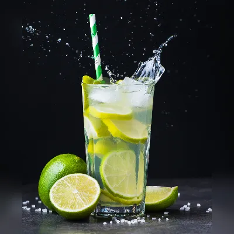
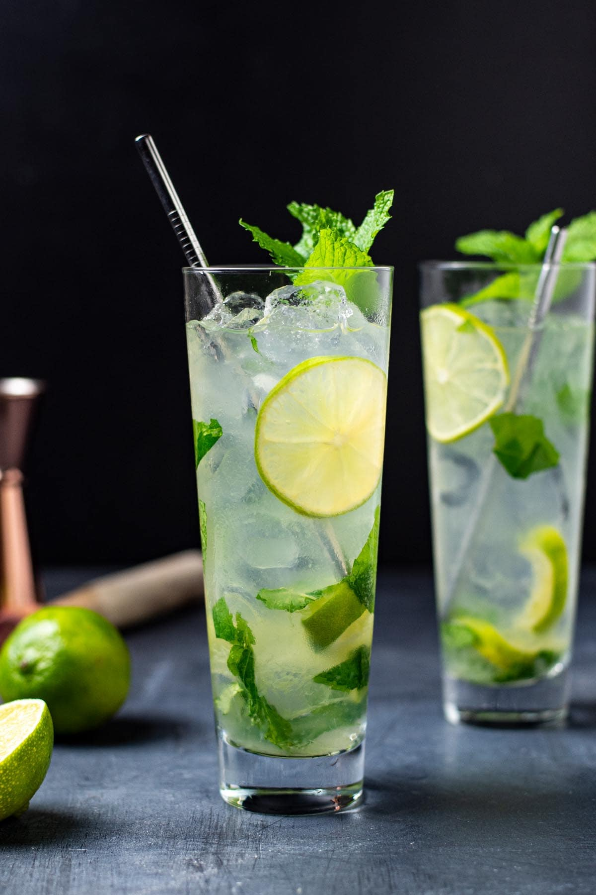
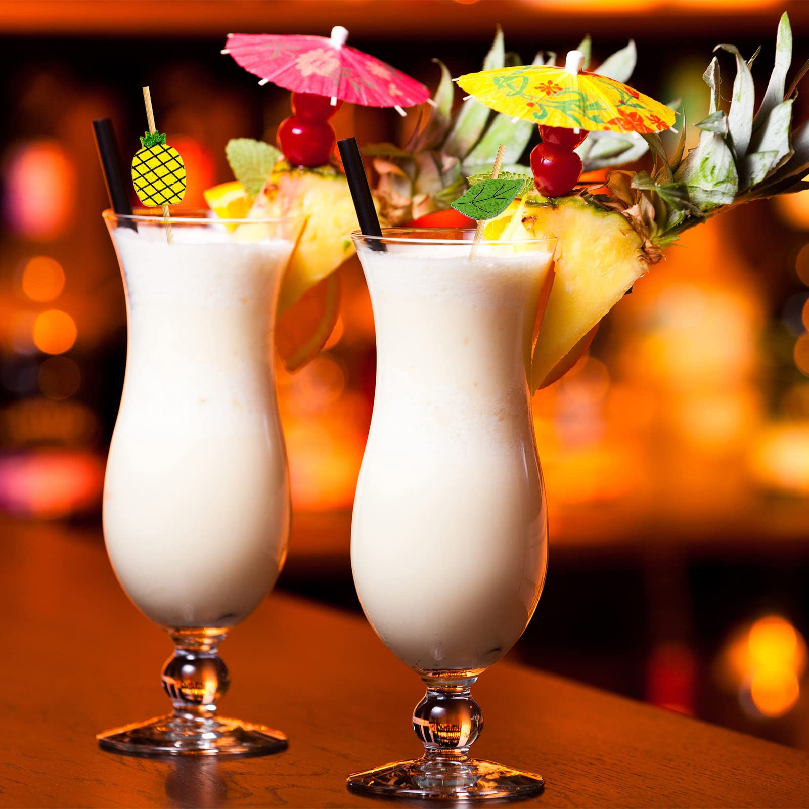
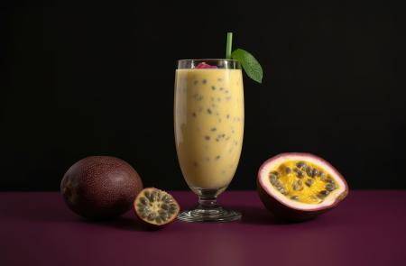
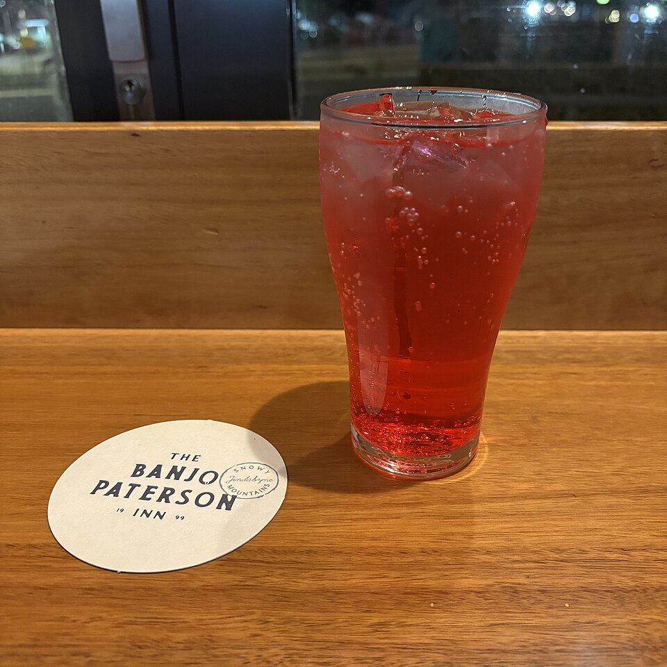
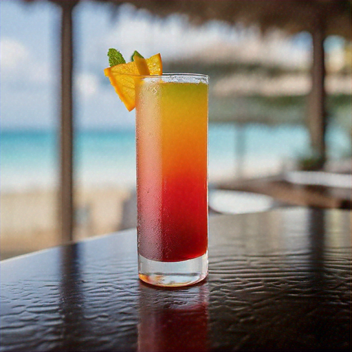

# 🍸 Cardápio de Bebidas · Formatura do Arthur

Cardápio digital de drinks com tema de TI, feito para a comemoração de formatura do Arthur Arash. Cada drink tem um "nome de código" (`mint.deploy()`, `kernel.colada()`...) e, ao clicar, mostra a foto e os ingredientes completos.

🔗 **Site:** [drinks.arash.com.br](https://drinks.arash.com.br)

<p align="center">
  
  
  
</p>

## ✨ Funcionalidades

- **Filtro por bebida base:** Todos, Cachaça, Vodca ou Rum, com contador de drinks.
- **Detalhes em modal:** foto, base, ingredientes e descrição de cada drink.
- **Animações com GSAP:** entrada em sequência, cards que aparecem ao rolar, barra de progresso e emoji que "pula" no hover.
- **Objetos 3D (Three.js):** taça de martini, gelos, limões, laranjas, hortelã, cerejas, guarda-chuvinhas, brilhos e bolhas flutuando pela página, inclusive perto do centro. Eles seguem o mouse, se movem com a rolagem e reagem ao clique (a área de clique é generosa e o cursor muda ao passar por cima). No modo claro as cores ficam mais fortes para continuarem visíveis. Quem preferir pode esconder tudo no botão 🧊 (a escolha fica salva e, desligado, o Three.js nem é carregado).
- **Lab do Bartender (`lab.html`):** segunda página, aberta pelo botão 🧪 no canto superior esquerdo. A pessoa monta o próprio drink em 5 passos (base, mistura, doçura, gelo e enfeite), o copo em SVG enche ao vivo, o drink ganha nome de código (`vodca.maracuja()`), receita e o drink parecido do cardápio. Tem botão de surpresa, copiar receita, "servir" com confete e link compartilhável (a escolha vai no `#` do endereço). Usa o mesmo tema claro/escuro e o mesmo som do cardápio.
- **Quiz "Qual drink pra mim?":** botão no canto inferior direito que faz 4 perguntas simples (clima, sabor, bebida base e doçura) e indica um drink do cardápio, com uma segunda opção.
- **Modo claro e escuro:** botão no canto da tela, com transição circular. Respeita o tema do sistema e lembra a sua escolha.
- **Sons:** clink de taça, cliques e sons nos objetos 3D, gerados no navegador (sem arquivos de áudio). Dá para silenciar no botão 🔊.
- **Cards em 3D:** os cards se inclinam suavemente com o mouse.
- **Leve e acessível:** só anima `transform` e `opacity`, navegação por teclado (`Enter`, `Espaço`, `Esc`) e respeita "reduzir movimento".
- **Responsivo:** funciona bem no celular, que é onde os convidados vão abrir.

## 🍹 O cardápio

| Código | Drink | Base |
| --- | --- | --- |
| `root.caipi()` | Caipirinha / Caipiroska / Daiquiri | Cachaça, vodca ou rum |
| `mint.deploy()` | Mojito | Rum |
| `passion.commit()` | Batida de Maracujá | Cachaça |
| `kernel.colada()` | Piña Colada | Rum |
| `pink.packet()` | Pink Lemon | Vodca ou rum |
| `sunset.compile()` | Vodca com Suco de Laranja | Vodca |

<p align="center">
  
  
  
</p>

## 🛠️ Tecnologias

- HTML, CSS e JavaScript puros, em um único arquivo (`index.html`), com as fotos dos drinks na pasta `img/`
- [GSAP 3](https://gsap.com/) + ScrollTrigger (via CDN) para as animações
- [Three.js](https://threejs.org/) (via CDN, carregado depois do site) para os objetos 3D
- Web Audio API para os sons
- Fontes [Inter](https://fonts.google.com/specimen/Inter) e [JetBrains Mono](https://fonts.google.com/specimen/JetBrains+Mono)
- Hospedado no GitHub Pages com domínio próprio (`CNAME`)

## ▶️ Como rodar

Não precisa instalar nada. Abra o `index.html` no navegador ou use um servidor local:

```bash
python3 -m http.server 8000
# abra http://localhost:8000
```

## ➕ Como adicionar um drink

No `index.html`, adicione um objeto ao array `drinks`:

```js
{
  emoji: '🍓',
  bases: ['vodca'],
  codename: 'berry.merge()',
  realName: 'Nome do drink',
  shortText: 'Resumo curto exibido no card',
  ingredients: ['Ingrediente 1', 'Ingrediente 2'],
  description: 'Descrição exibida no modal.',
  image: 'img/nome-da-foto.jpg'
}
```

Coloque a foto em `img/`. O card, o filtro e o contador se atualizam sozinhos. Para o quiz considerar o novo drink, adicione também uma entrada em `quizTags`.

## 🍸 Créditos

- Drinks por [@fabio_drinksdf](https://instagram.com/fabio_drinksdf)
- Foto do Pink Lemon: "Pink Lemonade.jpg" no [Wikimedia Commons](https://commons.wikimedia.org/wiki/File:Pink_Lemonade.jpg) (CC0). A foto original mostra um porta-copos de bar, por isso no site ela é enquadrada no copo.
- Criado por Arthur Arash Briceño Heidari
